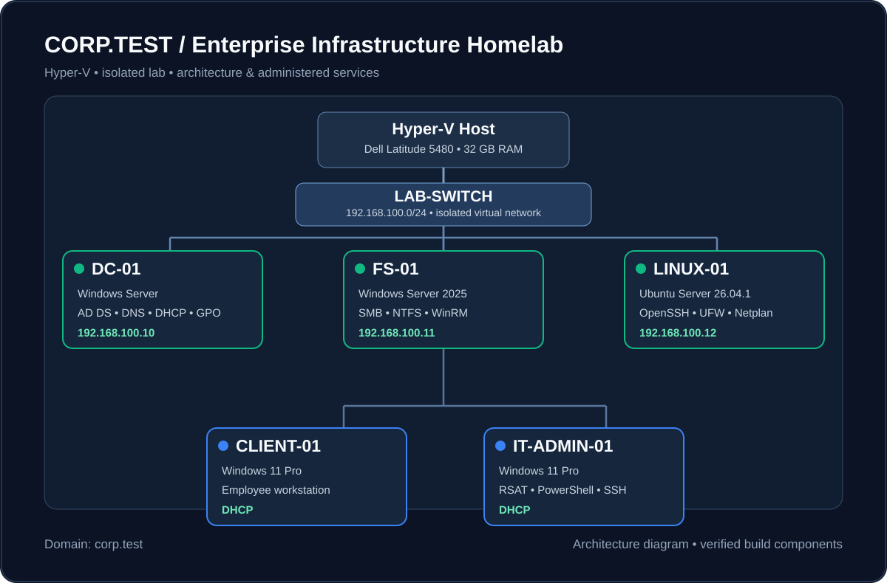
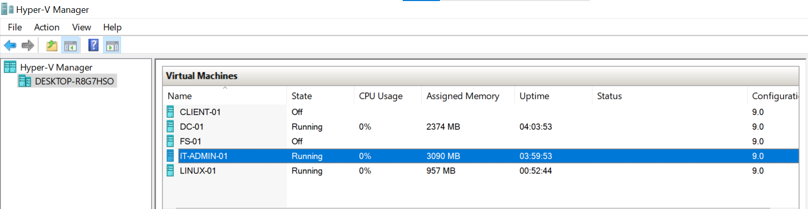
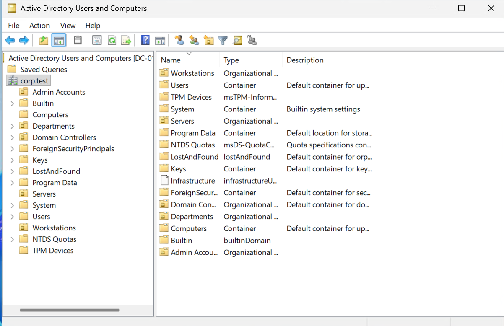
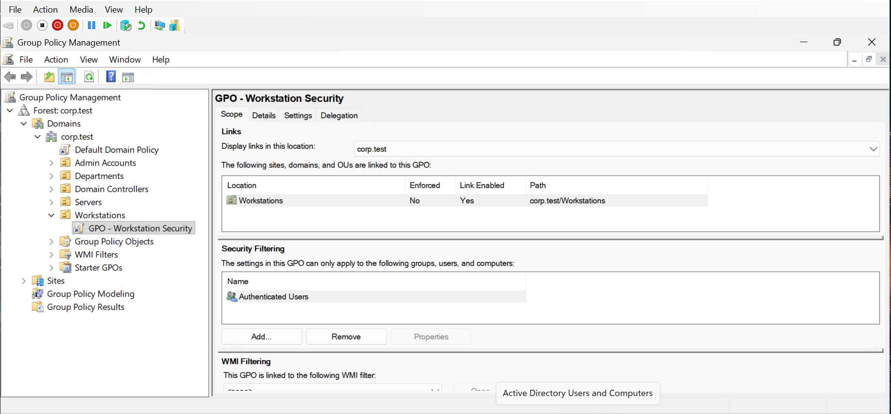
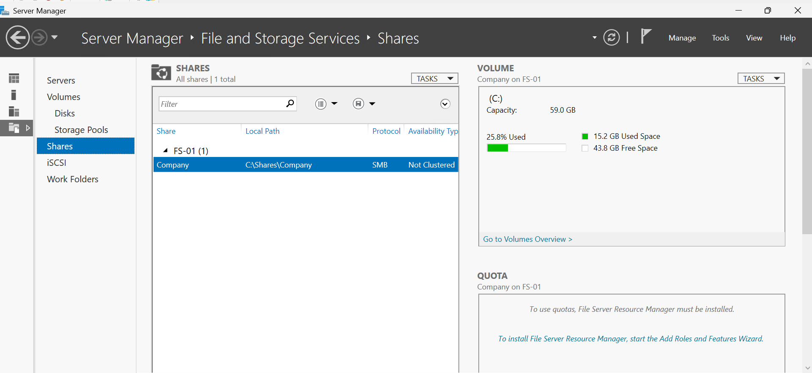
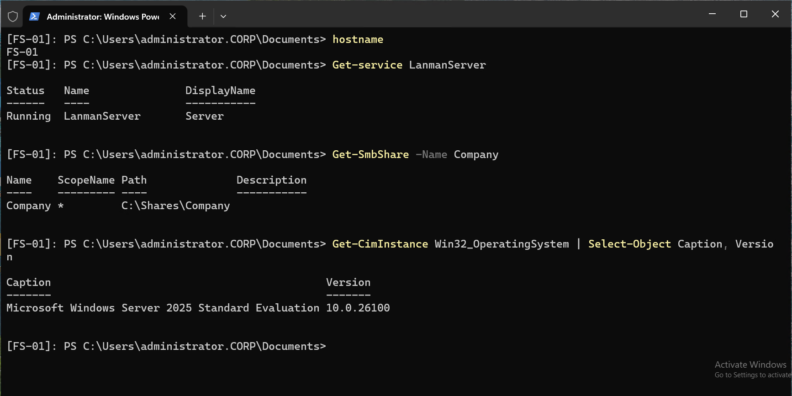
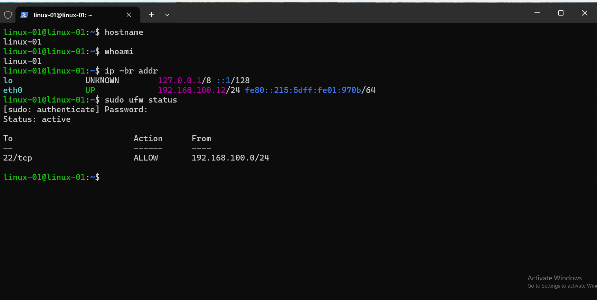

# Enterprise IT Infrastructure Homelab

**Windows Server 2025 | Active Directory | Hyper-V | Windows 11 | Ubuntu Linux**

## Project Overview

Designed and deployed a five-machine virtual enterprise network using Microsoft Hyper-V to strengthen hands-on skills in IT support, Windows Server administration, networking, and Linux administration.

The environment simulates a corporate IT infrastructure using the `corp.test` Active Directory domain and an isolated `192.168.100.0/24` network.

## Network Architecture

## Infrastructure

| Machine | Role | Network Configuration |
|---|---|---|
| DC-01 | Active Directory, DNS, DHCP, Group Policy | 192.168.100.10 |
| FS-01 | Windows Server 2025 File Server | Corporate network |
| CLIENT-01 | Windows 11 Employee Workstation | DHCP |
| IT-ADMIN-01 | Windows 11 Administration Workstation | DHCP |
| LINUX-01 | Ubuntu Server, SSH, Firewall | 192.168.100.12 |

All virtual machines communicate through an isolated Hyper-V virtual switch.

## Technologies Used

- Microsoft Hyper-V
- Windows Server 2025
- Windows 11
- Active Directory Domain Services
- DNS and DHCP
- Group Policy
- SMB and NTFS Permissions
- Remote Server Administration Tools (RSAT)
- PowerShell and WinRM
- Ubuntu Server 26.04.1 LTS
- OpenSSH and UFW Firewall

## Implementation

### 1. Active Directory Administration

- Deployed an Active Directory domain controller.
- Created organizational units for departments, workstations, and servers.
- Configured domain user accounts and security groups.
- Joined Windows workstations and the file server to the domain.
- Delegated password-reset permissions to a dedicated IT administrator account.

### 2. Networking and Group Policy

- Configured DNS and DHCP services.
- Created and tested a DHCP scope for corporate workstations.
- Implemented workstation security settings through Group Policy.
- Verified policy application using `gpupdate` and `gpresult`.

### 3. File Server Administration

- Deployed a dedicated Windows Server file server.
- Migrated shared folders using Robocopy.
- Preserved NTFS permissions during migration.
- Configured SMB sharing and departmental access restrictions.
- Verified access using a standard employee account.

### 4. Remote Windows Administration

- Installed RSAT on the dedicated IT administration workstation.
- Managed Active Directory, DNS, DHCP, and Group Policy remotely.
- Configured PowerShell Remoting through WinRM.
- Remotely verified Windows services and SMB shares.

### 5. Linux Server Administration

- Installed Ubuntu Server on Hyper-V.
- Configured a static IPv4 address.
- Installed and verified OpenSSH.
- Connected remotely from Windows using SSH.
- Configured UFW firewall rules to allow SSH access from the corporate subnet.

## Troubleshooting Experience

| Issue | Troubleshooting and Resolution |
|---|---|
| DNS resolution failures | Tested connectivity and DNS resolution to isolate the problem |
| RSAT installation failures | Diagnosed Windows Update connectivity and DNS configuration |
| Shared folder access denied | Investigated AD security group membership and NTFS permissions |
| File server migration | Used Robocopy and verified SMB and NTFS access |
| PowerShell Remoting failure | Identified an offline server and verified WinRM connectivity |
| Linux network configuration errors | Corrected YAML indentation and validated Netplan |
| Linux SSH firewall access | Configured and tested UFW rules for SSH |

## Project Screenshots

### 01 — Hyper-V Infrastructure

### 02 — Active Directory Structure

### 03 — Group Policy Management

### 04 — File Server and SMB Shares

### 05 — PowerShell Remoting

### 06 — Linux SSH Administration

## Skills Demonstrated

Active Directory administration, Windows Server configuration, network troubleshooting, RBAC and delegated administration, Group Policy, file server management, PowerShell, Linux administration, SSH, and virtualization.

## Project Scope

This is an independently built educational lab that simulates selected enterprise IT infrastructure and administration workflows. It is not a production deployment.

## Future Improvements

- Implement centralized monitoring and event collection.
- Automate common administrative tasks with PowerShell.
- Expand Linux administration and SSH security.
- Explore Microsoft Entra ID, Microsoft 365, and Intune integration.
